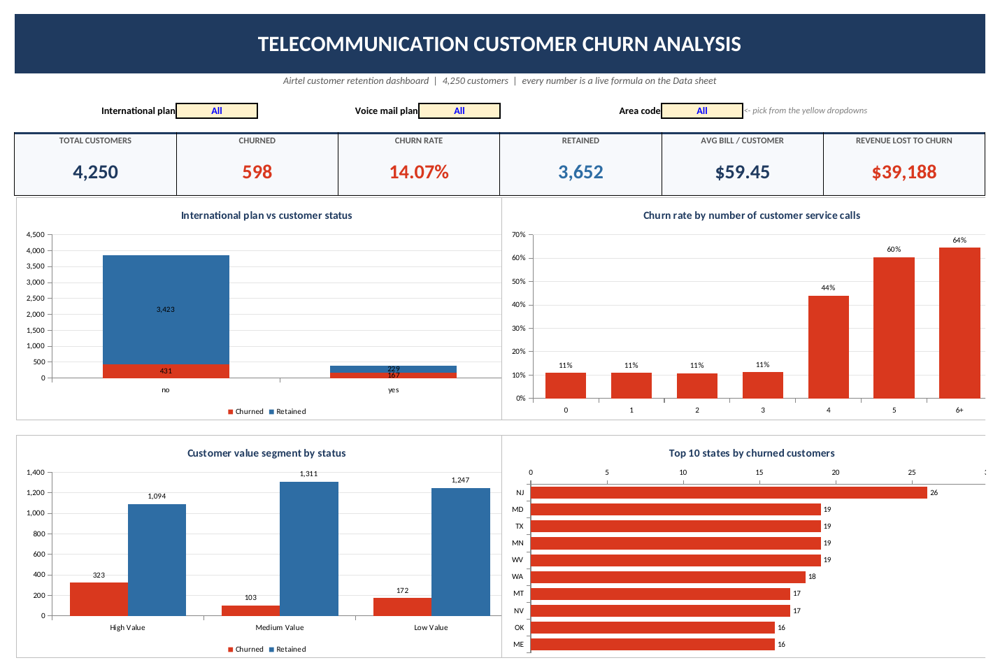
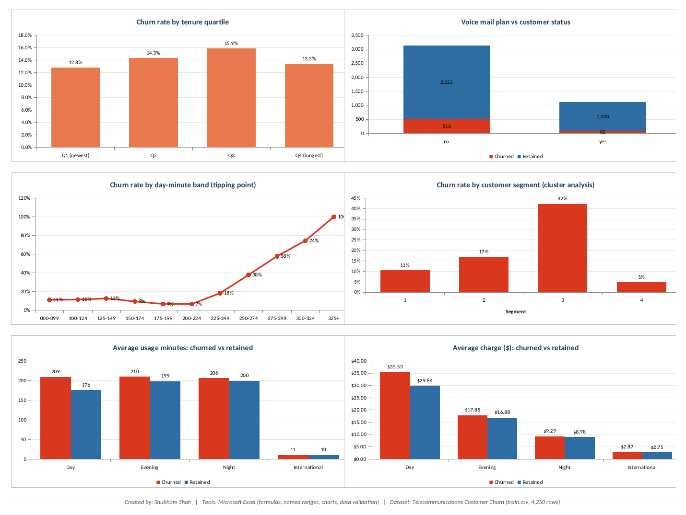

# Airtel Customer Churn Analysis

**ChurnQuest: Navigating the Waves of Customer Retention in Telecommunications**

An end-to-end customer churn analysis built entirely in Microsoft Excel. It answers the 25 questions of the case study (basic, medium and advanced) and ends with an interactive dashboard. Every number in the workbook is a live Excel formula, so changing the data refreshes the whole analysis.

---

## Dashboard Preview





The dashboard has three dropdown filters (International plan, Voice mail plan, Area code). Every KPI card and chart recalculates when a filter is changed.

---

## Repository Structure

```
Airtel-Customer-Churn-Analysis/
│
├── Airtel_Churn_Analysis.xlsx      # Final Excel workbook (25 answers + dashboard)
├── Customer_Churn_Dataset.csv      # Raw dataset (4,250 customers x 20 columns)
├── Dashboard_Part1.png             # Dashboard screenshot (top half)
├── Dashboard_Part2.png             # Dashboard screenshot (bottom half)
├── Problem_Statement.docx          # Case study: problem statement, data dictionary, 25 questions
└── README.md                       # Project documentation (this file)
```

---

## Project Overview

Airtel has seen a rise in customers leaving. This hurts revenue and market share, so management wants to know **why customers churn** so that retention efforts can be aimed at the right people. As the data analyst, my job was to dig into the customer data and find the patterns behind churn.

**Dataset:** Telecommunications customer churn data (Kaggle: *customer-churn-prediction-2020*). It has 4,250 customers with state, area code, tenure, plan details (international and voice mail), day / evening / night / international usage, customer service calls and the churn flag. There are no missing values and no duplicate rows.

---

## Project Requirements

The case study asked for answers to 25 questions at three levels:

**Basic (Q1 - Q10)**
- Churn count and share, tenure comparison, international plan and voice mail plan effects
- Customer service calls, day / evening / night charges, day minutes, international usage
- Correlation of day calls with churn

**Medium (Q11 - Q20)**
- Churn by area code, service-call thresholds and tenure quartiles
- International charges among plan holders, evening usage patterns, usage-based clusters
- Voice mail interaction, day-minute tipping point, international calls by plan, call-reason analysis

**Advanced (Q21 - Q25)**
- Logistic regression churn model (no machine learning models)
- Time series of churn, customer segmentation with clustering
- Interaction effects between attributes
- Economic impact (ARPU, customer lifetime value, revenue loss)

**Deliverable:** one Excel workbook with every answer calculated using formulas, followed by a dashboard.

---

## Tools and Technologies

- **Microsoft Excel** for the entire analysis and dashboard
- **Formulas used:** COUNTIFS, AVERAGEIFS, SUMIFS, SUMPRODUCT, INDEX / MATCH, LOOKUP, QUARTILE, PERCENTILE, CORREL, SLOPE, RSQ, MINVERSE, T.DIST.2T, CHISQ.TEST, NORM.S.DIST
- **Named ranges** (for example `Churn`, `DayMin`, `CSCalls`) to keep formulas readable
- **Helper columns** on the data sheet for tenure quartiles, call groups, value segments and clusters
- **Excel charts and data validation dropdowns** for the interactive dashboard
- **Statistical methods:** Welch t-test, chi-square test, correlation, logistic regression, k-means clustering, moving-average decomposition

---

## Workbook Guide

| Sheet | Contents |
|---|---|
| `Dashboard` | KPI cards, 10 charts, 3 filters |
| `Basic` | Q1 - Q10 |
| `Medium` | Q11 - Q20 |
| `Adv_Model` | Q21 logistic regression, plus the model part of Q24 |
| `Advanced` | Q22 time series, Q23 clustering, Q24 interaction cross-tabs |
| `Economic` | Q25 ARPU, CLV and revenue loss |
| `Dashboard_Data`, `Lookups` | Tables and cut-offs that feed the dashboard and helper columns |
| `Data`, `Model_Calc`, `Cluster_Calc` | Raw data, plus per-customer model scoring and cluster assignment |

Every question block follows the same pattern: the approach, the calculation, and a short **Finding** line that is itself a formula, so the text updates with the numbers. Yellow cells are inputs that can be changed.

---

## Key Insights

**Overall:** 598 of 4,250 customers churned, a churn rate of **14.07%** (about 1 in 7).

1. **International plan is the biggest red flag.** Plan holders churn at **42.2%** against **11.2%** without it. They are only 9.3% of customers but 27.9% of all churners. The regression puts the odds of churn at about 7.9 times higher. Every plan holder who made 2 or fewer international calls churned (74 of 74), and plan holders with a high international bill churn at 49.8% against 34.0% for low bills.
2. **Customer service calls have a clear tipping point.** Churn is flat at about 11% for 0-3 calls, then jumps to **44% at the 4th call**, 60% at 5 and 64% at 6 or more.
3. **Heavy daytime usage drives churn.** Customers using 250 or more day minutes (423 customers) churn at **48.9%**, against 10.2% for lighter users. Churn is lowest, about 7%, in the 175-224 minute range and rises sharply after that.
4. **Voice mail plan goes with staying.** Subscribers churn at 7.4% against 16.4% for others. The plan, not the number of messages, is what matters.
5. **Things that do not drive churn.** Tenure (correlation 0.02), area code (13.6% to 15.1% across the three), and number of day calls (correlation 0.01) show no meaningful link.
6. **Four customer segments** from clustering have very different risk. The international-plan group churns at **42%**, heavy day talkers at 17%, light users at 11%, and the voice-mail group at only 5%.
7. **Interactions matter.** International minutes only raise churn for plan holders. Heavy day usage and many service calls are substitute warning signs: once one is present, the other adds little. Adding interaction terms lifts the model's AUC from 0.83 to 0.87.
8. **Churn is expensive.** Churned customers account for about **$39,188 a month (15.5% of revenue)**, roughly $470K a year. They are above-average spenders (ARPU $65.53 against $58.46), and the estimated lifetime value lost is about $3.3 million under the stated assumptions.

---

## Challenges Faced

- **No date column.** The data has no timestamps, so a true time series was not possible. For Q22 I used account length (tenure) as the time axis and kept only tenure periods with enough customers. I have stated clearly that this is a tenure view, not a calendar trend.
- **No call-reason data.** Q20 asks about reasons for service calls, but the dataset has no such field. I used a proxy comparison of low, medium and high callers and found they look the same on plan, bill and tenure, which means the reasons must be captured at source.
- **No revenue column.** For Q25 I treated the sum of the four charge columns as one month of revenue and assumed a 12-month churn window and 100% margin. These are editable inputs on the `Economic` sheet and should be replaced with real finance figures.
- **Logistic regression and clustering in Excel.** Excel has no built-in function for these. The coefficients and cluster centres are stored as parameters, and everything built on them (scoring, standard errors, p-values, cluster assignment, convergence checks) is calculated with formulas. Checks inside the sheets confirm the parameters fit the data.
- **Keeping everything formula-driven.** Formulas had to work across 4,250 rows and several sheets without slowing the file down, so I used named ranges and helper columns instead of repeated long expressions. The final file is about 4 MB.
- **Statistical care.** Some groups are very small (for example the top day-minute band has only 15 customers), so those results are marked as indicative rather than conclusions.

---

## Recommendations

**For the business**
1. **Fix the international plan.** Move low-usage subscribers to a cheaper bundle before they leave, and add bill-shock alerts or a capped tariff for heavy international callers.
2. **Escalate at the 3rd service call.** A senior agent, a root-cause fix and a goodwill gesture before the 4th call could stop the jump in churn.
3. **Offer a day-time bundle early.** Target customers approaching 225+ day minutes with a capped or unlimited day plan before the bill grows.
4. **Use value-added services as stickiness.** Voice mail holders churn far less, so bundle similar add-ons into at-risk contracts. This is an association, so test it with a controlled offer.
5. **Target by behaviour, not by location or tenure.** Area code, tenure and call counts did not separate churners from stayers.
6. **Prioritise high-value, high-risk customers.** High-value customers account for most of the revenue lost to churn.

**For improving this project and the data**
1. Record a **call-reason code** in the support system so reason-level churn analysis becomes possible.
2. Add **dates** (billing month, churn date) to allow a real time series and seasonality analysis.
3. Add **actual revenue, margin and acquisition cost** to replace the assumptions in the economic analysis.
4. **Re-fit the model every quarter** and score customers monthly so the retention team always has a fresh at-risk list.
5. Run a **small controlled retention test** on the highest-risk group to confirm that the actions above really reduce churn.

---

## How to Use

1. Download `Airtel_Churn_Analysis.xlsx` and open it in Microsoft Excel (365 or 2016 and later recommended).
2. Start on the `Dashboard` sheet and use the yellow dropdowns to filter.
3. Open `Basic`, `Medium`, `Adv_Model`, `Advanced` and `Economic` for the detailed answers to each question.
4. Click any result cell to see the formula behind it.

---

## Author

**Shubham Shah**
Data Analyst | Excel, Data Analysis, Business Insights
GitHub: [ShubhamShah1](https://github.com/ShubhamShah1)
